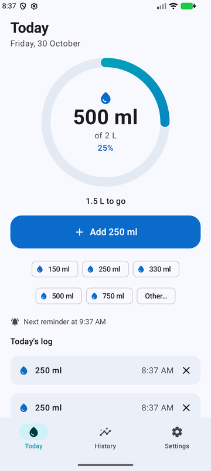
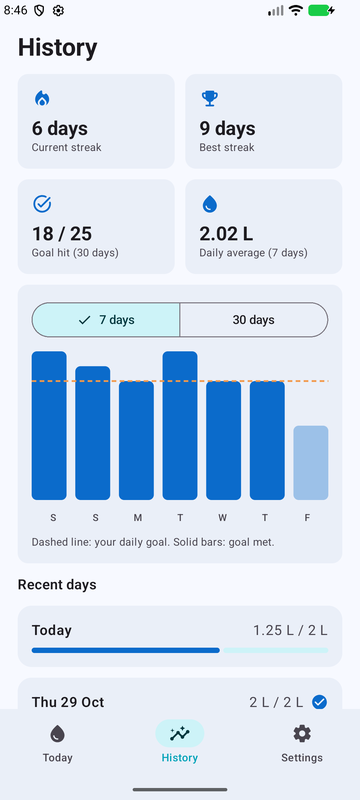
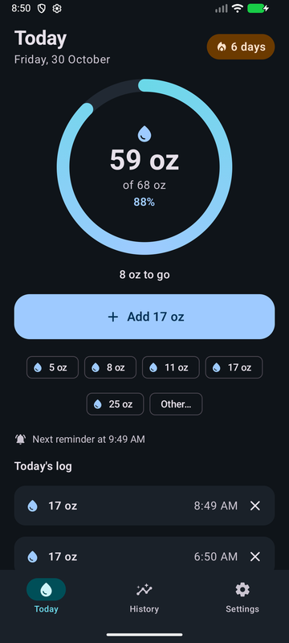
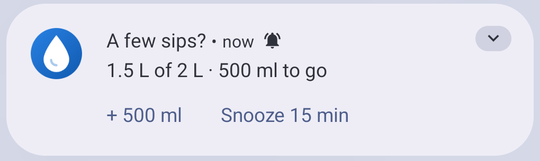
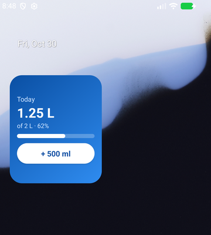

# Sip — a simple water tracker with no ads

I wanted a simple app to track how much water I drink each day, without the
ads every tracker in the store pushes on you. So I made one, and I'm sharing it
in case it's useful to anyone else.

It's free and open source under the [MIT licence](LICENSE): use it, change it,
fork it, ship your own version. **I'm not planning further updates.** It was a
small personal project to fill a need, and it does what I need. Issues and pull
requests may go unanswered, so if you want something different, fork it and
make it yours.

No ads, no account, no tracking, and no internet permission at all. Everything
stays on your phone.

<p>
  
  
  
</p>

## Features

- **One-tap logging.** The big button adds whatever you logged last, so your
  usual glass is a single tap. Quick-add sizes sit below it, plus "Other…" for
  any amount, optionally at an earlier time for the glass you forgot to log.
- **Undo** after every add or delete.
- **Reminders that vibrate**, with an optional sound. They respect your active
  hours (including night-shift windows that cross midnight), stop once your goal
  is met, and in smart mode count from your last drink, so drinking pushes the
  next reminder back.
- **Log from the notification.** Each reminder has "+ your usual amount" and
  "Snooze 15 min" buttons.

  

- **Home-screen widget** with today's progress and a one-tap add button.

  

- **Streaks**, current and best, plus your goal-hit rate, a 7-day average and a
  7/30-day chart. Tap any day to see each drink.
- **A goal you can change safely.** Past days keep the goal they had, so raising
  your goal never breaks an old streak. There's a weight-based suggestion (about
  35 ml per kg) if you're not sure where to start.
- Millilitres or fluid ounces, light and dark theme, optional Material You colours.
- **Backup and restore** to a file (for moving to a new phone), and CSV export.

## Install

Download the APK from the [latest release](../../releases/latest), open it on
your phone, and allow installing from that source when Android asks. Then open
Sip and allow notifications.

Requires Android 8.0 or newer.

On Samsung, Xiaomi, OnePlus and similar phones, also tap
**Settings → Make reminders reliable** if it appears. These phones aggressively
delay apps' alarms to save battery.

## If reminders don't vibrate or ring

Go to **Settings → Send a test reminder**. Sip sends one, then checks your phone
for anything that could be muting it, with a button to the right settings page
for each. The usual culprits:

- **Silent mode or Do Not Disturb.** Both stop notifications from vibrating, not
  just from making a sound. Vibrate mode is fine.
- **Sound is off by default.** Turn on **Play a sound** to hear reminders.
- **Notification vibration switched off** in the phone's sound settings.
- **Xiaomi, OPPO, realme, vivo, OnePlus, Huawei** phones can mute sound and
  vibration for newly installed apps. Open Sip's notification settings and turn
  sound, vibration and pop-ups back on.

## Building it yourself

You need JDK 17+ and the Android SDK (platform 36). Android Studio works too:
just open the folder.

```
./gradlew testDebugUnitTest   # unit tests
./gradlew assembleDebug       # app/build/outputs/apk/debug/app-debug.apk
```

`assembleRelease` signs with the debug key unless you add your own. To sign
with your own key, create a `keystore.properties` in the project root (it's
git-ignored):

```
storeFile=keystore/your-key.jks
storePassword=...
keyAlias=...
keyPassword=...
```

A phone only accepts an update signed with the same key as the installed app.
The APK in the releases is signed with my key, so if you build your own, you'll
need to uninstall that version first. Use **Settings → Back up** before you do,
then restore afterwards.

## How it's put together

- Kotlin and Jetpack Compose (Material 3), one activity with three tabs.
- Drinks are stored in SQLite (`WaterRepository`); settings in SharedPreferences.
- Reminders use exact `AlarmManager` alarms, which fire on time even when the
  phone is idle. (WorkManager batches work and can drift by tens of minutes.)
  Alarms are re-armed after a reboot, an app update or a time-zone change.
- Android fixes a notification channel's sound and vibration when it is
  created, so "sound on/off" is two channels and the setting picks one.
- The reminder scheduling rules (`ReminderPlanner`), streaks and goal history
  (`Stats`), and the backup format are plain functions with unit tests. They're
  the place to start if you want to change how the app behaves.
